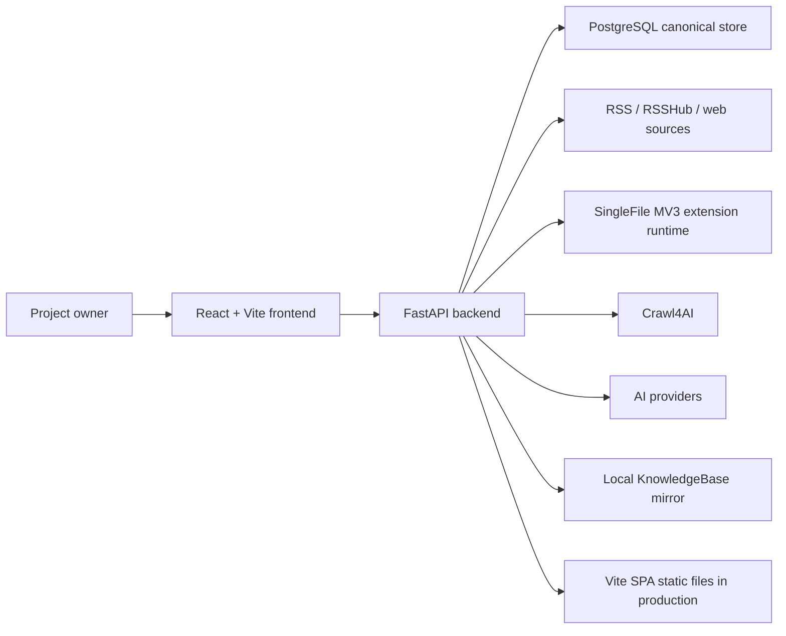

# Architecture

InfoFlowAggregator is one FastAPI/Vite application over a PostgreSQL canonical store, with app-local operation/job workers and rebuildable filesystem exports. It has no required external application worker, scheduler, cache, object store, or second database. Source deletion removes source-owned current material while retaining saved Knowledge items according to the data ownership contract. Manual import stores original uploaded material before derived processing and changes the current source pointer only after successful processing. Channel/routing corrections are canonical human evidence in `feed_item_structured_feedback`; AI-derived rows live in `insight_engine_artifacts`; source routing and preference settings have dedicated PostgreSQL owners; homepage read-model rows are derived and rebuildable; and Local Mirror is a derived filesystem export.

## System Context



## Containers

| Container | Role | Important files |
| --- | --- | --- |
| Frontend | Three-pane UI, view state, API adapters, local filtering | `frontend/src/App.tsx`, `frontend/src/hooks/use-info-flow-app.ts`, `frontend/src/components/*`, `frontend/src/services/*` |
| Backend API | HTTP routes, request validation, transaction boundary | `backend/app/main.py`, `backend/app/api/router.py`, `backend/app/api/routes/*` |
| Backend services | Domain logic for sources, reader, homepage, knowledge, settings, capture, mirror | `backend/app/services/*` |
| Database | Canonical state and raw/replayable artifacts | `backend/app/db/models.py`, `backend/alembic/versions/*` |
| Local mirror | Derived filesystem export for readable KnowledgeBase archive files | `KnowledgeBase/`, `backend/app/services/knowledge_mirror.py` |
| Production app image | Single deployable image that serves the FastAPI API and the built Vite SPA, and includes capture tool runtimes | `Dockerfile`, `backend/requirements-runtime.txt`, `docker/app-entrypoint.sh`, `backend/app/main.py`, `deploy/docker-compose.yml` |

## Deployment Runtime

The supported personal deployment uses one application Docker image. In production, app startup requires `INFOFLOW_ALLOW_UNAUTHENTICATED_PRODUCTION_API=true` to acknowledge that this personal API relies on external access control rather than app-layer authentication; FastAPI OpenAPI/docs routes are disabled. The image contains:

- the FastAPI backend;
- the Vite frontend build served by FastAPI static file handling;
- the vendored SingleFile MV3 extension runtime under `/app/vendor/singlefile-mv3`, driven by Playwright persistent Chromium;
- Crawl4AI and full Playwright Chromium runtime assets, plus Xvfb and CJK/emoji fonts for headful extension capture in Linux containers;
- Alembic migration tooling, with `20260602_homepage_rm` as the current head.

The Docker image uses the vendored SingleFile MV3 extension rather than the removed SingleFile CLI path. `SINGLEFILE_EXTENSION_PATH`, `SINGLEFILE_EXTENSION_ID`, `SINGLEFILE_BROWSER_EXECUTABLE_PATH`, and `SINGLEFILE_CAPTURE_TIMEOUT_SECONDS` configure that runtime.

`backend/requirements-runtime.txt` is the Docker runtime dependency input and must match the `[project].dependencies` list in `backend/pyproject.toml`; `backend/tests/test_config.py` enforces this. The Docker runner installs third-party dependencies before Playwright/Chromium, installs browser assets before the app wheel, and installs the app wheel without re-resolving dependencies. Dependency and browser layers therefore remain reusable when only application code or git metadata changes.

The backend process owns an app-local PostgreSQL job queue for selected operation families and a dedicated in-process AI lane over the same job tables. `app_operations` is the frontend progress/result contract; `jobs` and `job_events` own child execution, claim, lease, retry, and cancellation. Job-backed operations recover through child state and lease reclaim, while legacy same-process active rows may become `interrupted` after restart. Public operation creation routes enqueue, commit, wake the worker, and return without draining jobs inline. Stop requests set intent in a short transaction; worker context owns child cancellation and terminal synchronization. Channel correction is a synchronous human-evidence write. Source Profile activation is a local settings write that marks affected homepage projections stale rather than synchronously rebuilding them. Channel retirement persists the catalog change before asynchronous derived rerouting. Coverage inspection remains a read-only projection over current PostgreSQL and configuration state.

Security and remote-fetch boundaries are owned by [`security.md`](security.md). `backend/app/core/security.py` implements secret encryption/decryption, masking, redaction, and persisted payload validation. `backend/app/core/safety.py` implements safe XML parsing, public HTTP URL validation, redirect checks, SSRF guards, and request/response byte caps.

The current schema enforces `insight_engine_artifacts` owner/kind integrity: feed-item artifacts use `feed_item_id`, while `saved_item_insight_v1` uses `saved_item_id`. Current feed-item-owned artifact kinds are `feed_item_*_v1`; legacy `homepage_*_v1` names are not accepted as current runtime input. Composite indexes support latest artifact reads by `(artifact_kind, feed_item_id, id DESC)` and `(artifact_kind, saved_item_id, id DESC)`.

The app container starts through `docker/app-entrypoint.sh`. Startup runs `alembic upgrade head` before launching:

```text
uvicorn app.main:app --host 0.0.0.0 --port 8000
```

The production compose bundle is under `deploy/` and is intended to be copied without a git checkout or local build on the target machine. By default it runs:

- `app`, using a published image such as GHCR;
- `postgres:16`;
- `diygod/rsshub:chromium-bundled`;
- `redis:alpine`, used only as RSSHub's cache backend.

RSSHub is internal to the compose network for app traffic. InfoFlowAggregator reaches it through `RSSHUB_BASE_URL=http://rsshub:1200`; RSSHub itself uses `CACHE_TYPE=redis` and `REDIS_URL=redis://redis:6379/` by default. The optional host mapping uses `${RSSHUB_HOST_BIND:-127.0.0.1}:${RSSHUB_PORT:-1200}:1200`, so local browser debugging can use `http://127.0.0.1:1200/healthz` without exposing RSSHub to the LAN by default. Route-specific RSSHub credentials such as `TWITTER_AUTH_TOKEN` and `YOUTUBE_KEY` belong in the deployment `.env` and are passed only to the RSSHub service.

The default production app data path inside the app container is `/data/KnowledgeBase` for the rebuildable Local Mirror. Compose mounts host `./KnowledgeBase` to `/data/KnowledgeBase` by default, and `HOST_KNOWLEDGE_BASE_ROOT` can point that host-side mount at an absolute external directory. DB-backed storage path overrides should use container-visible paths that are actually mounted into the container. `llm_wiki/` remains a reserved future workspace, but it is not a current compose mount, environment variable, or Settings API field.

## Source Of Truth Layers

| Layer | Canonical location | Meaning |
| --- | --- | --- |
| Source raw | `source_import_runs`, `source_fetches.response_body`, `source_item_occurrences.raw_entry_json` | Raw imported/fetched material for debugging and replay |
| Source routing settings | `insight_channels`, `insight_channel_catalog_state`, `source_channel_tendencies`, `sources.flow_policy` | Configurable channel definitions, catalog version state, and source-level routing tendencies used as AI prompt context, optimistic Settings writes, lifecycle audit, and deterministic routing fallback inputs |
| Source preference settings | `source_preference_profiles` | Optional per-source draft/active/history Source Profiles. Active profiles render source-specific preference prompt context and source scoring features for future Insight jobs; they do not mutate routing tendencies or historical artifacts. |
| Feed item | `feed_items`, `source_item_occurrences`, `item_states`, `feed_item_structured_feedback`, `feed_item_behavior_events` | Normalized subscription item, item-level free-form/structured/channel-correction human insight feedback, current reading state including `seen_at`, and append-only behavior evidence |
| Saved item | `saved_items`, `saved_snapshots`, `saved_item_assets`, `saved_item_curated_insights`, `saved_item_curated_insight_events` | Capture inbox and knowledge base truth, including nullable URL identity, uploaded source material, upload processing state, saved item AI route privacy state, user-curated saved item insight revisions, and edit history |
| AI derived | `insight_engine_artifacts` | Recomputable homepage summaries/topics/ranking/routing, grouped feature/score/routing audit payloads, and AI generated saved item insights, represented in code as `InsightEngineArtifact`. |
| Insight scoring projection | no score table; `backend/app/services/insight_scoring.py` plus DB-backed controls in `app_settings` | Replayable priority score, grouped `InsightFeatureVector`, deterministic flat contribution view, and optional automatic low-priority bucketing derived from existing PostgreSQL rows |
| Homepage read model | `feed_item_homepage_read_models`, `feed_item_homepage_facets` | Rebuildable derived card projections, expanded filtering/sorting/count fields, and channel/topic facets for homepage bootstrap/summary/items reads. These rows are not canonical and can be deleted and rebuilt from feed items, latest source occurrences, item states, structured feedback, source/channel/profile/settings state, and latest feed-item Insight Engine artifacts. |
| Insight diagnostics | `insight_engine_attempts` plus read-only coverage projection | Historical failed/skipped feed item insight attempt records with sanitized request snapshots, parse/repair metadata, and routing diagnostics; the read-only coverage projection is the current item-status view and explains missing feed item artifact coverage from existing feed items, source routes, provider settings, latest attempts, and extraction status |
| Operation state | `app_operations`, `jobs`, `job_events` | Operation state for source sync, feed item missing-artifact fill, channel lifecycle reroute, capture, local mirror export, feed-item extraction/artifacts, and saved-item insight rebuild; `app_operations` remains the frontend progress/result contract, while selected operation families use local Postgres child jobs for claim/lease/retry/cancel where supported |
| Insight contracts | `backend/app/services/insight_engine_contracts.py` | Code-level controlled taxonomy, content type, and reason-code options used to constrain generated Insight Engine artifacts |
| Insight profile versions | `insight_profiles`, `insight_profile_events` | User-created/imported profile versions plus activation/rollback event history; no migration-seeded default row. Draft inspection is a read-only projection over candidate JSON plus the active/default profile. |
| Insight evidence package | Generated ZIP response | Read-only export over feed items, structured feedback and channel-correction evidence, item states, feed item behavior events, saved item evidence, latest homepage/saved item artifacts, active/default profile, routing/channel settings, evidence signal classification, and code-level contracts for offline profile updates |
| App settings | `app_settings` | User-editable runtime settings such as storage roots, RSSHub base URL, AI profile configuration including artifact concurrency, and Insight Engine controls. AI API key values are encrypted with `INFOFLOW_SETTINGS_ENCRYPTION_KEY` when saved through Settings; process env overrides can supply keys without changing database rows. |
| Local mirror | `KnowledgeBase/` plus mirror export tables | Rebuildable filesystem view, not canonical |

## Runtime Flows

### Source Ingestion

1. UI calls source preview/create/import endpoints directly. Source sync starts through `/api/operations/source-sync`; older synchronous source sync routes are not part of the v3 API.
2. `source_registry.py` validates and stores source records.
3. `operations.py` creates the visible `source_sync` operation, enqueues one `source_sync_one_source` child job for a single source or one child job per selected active source for all-source sync, commits the transaction, wakes the operation job worker, and returns without draining source jobs inline.
4. `source_sync.py` fetches one source through the shared SSRF/size-guarded HTTP helper, parses RSS/Atom through defused XML parsing, and normalizes entries through `sync_one_source`.
5. Source sync selects at most the latest 50 entries for ingestion, ordered by entry `published_at` and falling back to original feed order when published time is absent. The larger `FEED_ENTRY_MAX_COUNT` parser limit remains only a safety guard for oversized feed documents.
6. Selected feed entries become `feed_items` plus `source_item_occurrences`. Newly created `FeedItem` rows and their initial `ItemState` rows are committed in the same source transaction. Non-null canonical URL identity is protected by PostgreSQL partial unique index `uq_feed_items_canonical_url_not_null`; unique conflicts reload the existing `FeedItem`.
7. Source sync may run item-level short-content extraction as part of source ingestion.
8. Source sync records `source_fetches` and child job results. True access failures retry before becoming terminal source results: `fetch_failed:` diagnostics and upstream HTTP `429/500/502/503/504` retry within bounded attempts, while `400` and URL safety failures do not retry. Exhausted fetch/parse/HTTP failures become fetch/result diagnostics rather than inline AI failures.
9. Source sync does not call LLM providers or the feed item insight artifact builder inline. When `feed_item_insight_artifact_build_limit` is a positive integer or `null`, each successful `source_sync_one_source` job creates or reuses a linked visible `feed_item_insight_artifacts` operation with internal kind `source_sync_created_feed_items`, then enqueues one `feed_item_insight_artifact_build` job per selected newly created feed item.
10. Operation runners persist progress and fan-in results from child jobs. Cooperative stop cancels pending source jobs immediately and lets a running source job finish at its safe boundary; stop requests on the parent source-sync operation are also forwarded to the linked artifact build operation. Linked source-sync insight artifact counters are reflected back into parent source-sync result cards so source-level result rows can show processed/generated/failed insight counts.

Main files:

- `backend/app/api/routes/sources.py`
- `backend/app/api/routes/operations.py`
- `backend/app/services/operations.py`
- `backend/app/services/operation_jobs.py`
- `backend/app/services/source_registry.py`
- `backend/app/services/source_preview.py`
- `backend/app/services/source_sync.py`
- `backend/app/services/insight_engine_artifact_builder.py`
- `backend/app/services/insight_engine_artifacts.py`

### Channel Lifecycle

Insight Channels are runtime configuration, not a static code enum:

1. Settings reads and writes channels through `/api/settings/insight-channels`, with `channel_catalog_version` used as an optimistic lock for create/update/retire.
2. `insight_channels.id` remains the stable channel id. The current contract does not expose hard delete or id rename; removal means retire.
3. `needs_review` is a locked system channel used as the fallback when AI output is missing, stale, disabled, retired, unknown, or otherwise ambiguous.
4. Active channels are `enabled = true` and `retired_at is null`; only active channels enter request schemas, deterministic fallback, source tendency saves, and new human correction saves.
5. Retiring a channel marks it retired and disabled in the same transaction, increments the catalog version, creates a `channel_lifecycle/retire_channel` operation, and enqueues `channel_reroute_item` jobs for affected feed items.
6. Each reroute job appends a new `feed_item_routing_v1` artifact with `routing_source = channel_lifecycle` and lifecycle metadata. It does not mutate historical AI artifacts, rewrite source tendencies, or author fake human feedback.
7. `channel_lifecycle` operations are globally mutually exclusive with source sync and feed item insight artifact work. They are not stoppable after retirement starts; recovery relies on idempotent jobs and lease reclaim.

Main files:

- `backend/app/api/routes/settings.py`
- `backend/app/services/insight_channels.py`
- `backend/app/services/channel_lifecycle.py`
- `backend/app/services/operations.py`
- `backend/app/services/operation_jobs.py`
- `backend/app/services/insight_engine_artifacts.py`
- `frontend/src/components/insight-channel-settings-panel.tsx`
- `frontend/src/hooks/use-info-flow-app.ts`

### RSS Short Content Extraction

Source sync includes item-level handling for feed entries whose RSS body is only a source link, jump prompt, or very short summary.

Implemented boundaries:

1. Source sync saves the original RSS/Atom content candidate first in `feed_items.feed_content_text`.
2. `feed_items.content_text` remains the current effective reader/homepage/AI body. It starts from feed content or summary, and is replaced only when source-page extraction succeeds.
3. The extraction decision is per `feed_item`, based on visible text length, URL-only bodies, jump-prompt templates, source marker, previous success, and recent failure cooldown. There is no source-level extraction preference and no new extraction table.
4. Default extraction is a lightweight feed path: `httpx` fetches item HTML, follows HTTP redirects and up to two in-page `meta refresh` redirects, does not treat `<link rel="canonical">` as a redirect, passes the final fetched URL to `readability-lxml`, stores reader HTML when quality gates pass, normalizes `a href` and `img src` to absolute `http/https` URLs, and strips `img srcset`. Reader-stage image URLs are remote display references only, not archive assets.
5. Quality gates compare extracted content against the original feed baseline: `feed_content_text` first, then `summary_text`, and only non-`extracted_page` current `content_text` as a last resort. Existing extracted page content must not become the baseline for forced re-extraction.
6. `trafilatura` remains the text fallback when `readability-lxml` fails or fails quality gates. Crawl4AI remains owned by capture/archive and is not the default feed-sync short-content extractor.
7. On success, the item records `content_text_source = extracted_page`, updates extraction timestamps/status, clears the latest extraction error, and triggers feed item Insight Engine artifact regeneration for that item.
8. On failure, the original RSS-derived body or previous extracted body stays readable, while the item records the latest failed status/error/debug data for diagnosis. Manual debug payloads include `html_redirects` when in-page redirects were followed.
9. Manual “report and extract content” starts `POST /api/operations/feed-items/{feed_item_id}/extract-content`, writes `content_extraction_debug_json`, and forces one extraction attempt without creating source-level learning rules.

Main files:

- `backend/app/db/models.py`
- `backend/alembic/versions/20260601_v3_0_0_baseline.py`
- `backend/app/services/feed_content_extraction.py`
- `backend/app/services/source_sync.py`
- `backend/app/services/reader.py`
- `backend/app/services/insight_engine_artifacts.py`
- `backend/app/api/routes/reader.py`
- `frontend/src/components/detail-pane.tsx`
- `frontend/src/services/feed-service.ts`

### AI Homepage

1. UI calls `GET /api/homepage/bootstrap` for the first summary plus item window, `GET /api/homepage/items` for subsequent cursor windows, and `GET /api/homepage/summary` when operation completion should refresh counts/facets without replacing visible cards.
2. `homepage.py` owns `HomepageQuery` filtering, search, time-window filtering, full-result summary/facet counts, ordering, opaque cursor validation, and reader-like card reads. Fresh requests use `feed_item_homepage_read_models` plus `feed_item_homepage_facets` for SQL filtering, count/group facets, ordering, and card JSON reads. Missing or stale read-model rows trigger or confirm a background rebuild and may use the legacy live projection for that request while returning `read_model_status`.
3. `insight_engine_artifacts.py` resolves latest valid summary/topic/routing artifacts and deterministic fallbacks. Existing and newly generated homepage summary artifacts are re-cleaned so URL-only "read more" jump prompts do not become display summaries.
4. `insight_scoring.py` computes the final homepage `priority_score`, `priority_band`, signed `priority_reasons`, `low_priority_bucket`, `low_priority_bucket_reason`, `auto_low_priority_cleared`, and `priority_source = backend_scoring_v1` from a grouped `InsightFeatureVector` and deterministic `score_v1_hand_weighted` contribution breakdown. It reads latest feed-item artifacts as content signals, the active Insight Profile, active Source Profiles, `feed_item_behavior_events`, current `item_states`, latest source occurrences, controlled taxonomy `topic_ids`, and DB-backed Insight Engine settings. Current `not_interested` is a strong reversible negative contribution and low-priority bucket reason, not a deletion or hidden artifact mutation; automatic score-threshold bucketing is optional and disabled by default. The resulting homepage card projection is persisted in a rebuildable read model rather than recomputed across the full matching set on every fresh request.
5. `insight_engine_artifact_builder.py` is the only module that calls an external AI provider for feed item insight artifacts. Its canonical per-item entry point builds `feed_item_summary_v1`, `feed_item_topics_v1`, `feed_item_ranking_v1`, and `feed_item_routing_v1` in build-missing or rebuild mode. Build-missing writes only absent kinds; rebuild appends a new latest set while preserving history. The current contract keeps `key_points` out: `feed_item_summary_v1` stores the summary, while ranking/routing artifacts store feature, scoring, routing, and fallback audit metadata.
6. Runtime Insight Engine request payloads are built by `insight_engine_request_builder.py`. The real feed item Insight Engine artifact path and the Settings request inspector both use this shared builder so previewed messages and request bodies stay aligned with production provider calls. The runtime prompt sends only `Title`, `Source name`, `Source folder`, and normalized `Content` (`content_text`, falling back to `summary_text` only when `content_text` is empty). URL, published time, reader status, and a separate RSS summary field are intentionally excluded from the external AI prompt.
7. The shared prompt injects slim taxonomy/content type/reason-code contexts, slim active Insight Profile context, active-or-empty Source Profile context, active dynamic Insight Channel context, active source channel tendencies, and source flow policy. Source Profile context comes from the latest active `source_preference_profiles` row when present and otherwise from the canonical empty payload. Its system message explicitly frames the task as judging whether the article deserves priority and how it should route for the current reader, producing a strict JSON object, using Simplified Chinese for `summary` and `priority_reasons[].label`, and keeping `topics`, `content_type`, `priority_reasons[].code`, routing channel ids, reading depth, and flow lane as controlled ids/codes. Contract version/status metadata remains backend-side and is not sent to AI providers.
8. AI provider configuration is read from DB-backed settings. The app has two fixed profiles: `general` for normal sources and `sensitive` for sources that should avoid the general provider. `sources.ai_route` selects `general`, `sensitive`, or `disabled` per source. Each AI profile also stores `artifact_concurrency`, which throttles artifact and saved-item insight jobs by AI profile/provider without affecting source sync fetch concurrency.
9. `ai_provider.py` selects request shape by explicit provider. `deepseek` calls `/chat/completions`, sends the configured `thinking.type`, uses `json_object`, and keeps the DeepSeek compatibility fallback. `openai-compatible` calls `/v1/chat/completions`, uses `json_object`, and is kept for OpenAI-style gateways and proxies. `lm-studio` calls `/v1/chat/completions`, can omit `Authorization`, and uses route-specific `json_schema` response formats for `connection_test`, `feed_item_insight`, and `saved_item_insight`; schema rejection is reported as a provider error rather than silently retried without `response_format`.
10. Source sync never invokes the builder inline. As each `source_sync_one_source` job succeeds, it may create or reuse a linked `feed_item_insight_artifacts/source_sync_created_feed_items` operation and enqueue per-item artifact build jobs for newly created feed items. Omitted or `null` `feed_item_insight_artifact_build_limit` means all newly created items, `0` skips automatic feed item Insight Engine artifact work, and a positive integer caps the linked build item count.
11. AI Insight jobs are scheduled by one AI lane worker inside the backend process. Public operation APIs and source-sync follow-up paths persist operation/jobs and wake the lane; they do not drain AI jobs in the request/background operation path. The generic operation worker also excludes AI lane job types. The AI lane uses the existing Postgres job claim/lease/retry model, but it keeps an in-memory sliding window of futures and refills a provider slot immediately when an in-flight job finishes. The worker still synchronizes `app_operations` from job state after completions, so the frontend continues to poll the same operation contract.
11. Normal feed-item artifact build-missing and rebuild operations also enqueue per-item artifact jobs and use the same builder as the source-sync-created follow-up.
12. `GET /api/feed-item-insight-artifacts/missing-candidates` lists feed item ids missing one or more feed-item artifact kinds, optionally scoped by source and limited for batch UI work.
13. Global/current-source feed item artifact maintenance and Settings coverage batch actions all start through `POST /api/operations/feed-item-insight-artifacts` as one visible job-backed operation per batch. The preferred Settings UI path is item-centric `retryable_coverage` with reason-code filters; the backend `failed_attempts` scope remains compatible for current failed items that are still missing artifacts, not as a guarantee that historical failed attempt rows disappear.
14. Single-item feed item artifact missing-build or rebuild starts through `POST /api/operations/feed-items/{item_id}/insight-artifacts` with `mode = build_missing | rebuild`.
15. The old `/api/homepage/.../artifacts/*` mutation routes are removed in v3; current artifact writes run through operation/job-backed paths only.
16. `GET /api/settings/ai/insight-request-preview` defaults to a recent non-disabled-source feed item, exposes a candidate list, accepts optional `item_id` to preview another candidate, and returns a sanitized preview of the shared request payload. It does not call AI, create provider HTTP clients, write `insight_engine_artifacts`, or expose API keys/authorization headers; when the selected profile is disabled or incomplete, it still can show the payload with `can_send = false`.
17. AI response handling performs one immediate malformed-JSON repair retry inside the current attempt only. Malformed JSON `response_parse` failures do not trigger job-level retry; feed item insight job-level retry is reserved for `provider_request` access failures. Successful parse then validates schema, canonicalizes taxonomy ids or Chinese labels, falls unknown topics back to `uncategorized`, falls unknown content types back to `unknown`, filters reason codes to the current AI-allowed subset, replaces reason labels from the contract, and clamps reason weights to 0-100. Failed attempts record sanitized parse/repair metadata and do not write partial success artifacts.
18. If an AI response has no valid AI-allowed reason code, summary/topic/ranking output is treated as invalid and those rows are not written for that item. Routing is validated independently: invalid, omitted, unknown, disabled, or retired channel references fall back to the locked `needs_review` channel with explicit reason metadata while valid summary/topics/ranking output can still be persisted.
19. AI-provided `priority_score` remains readable as legacy raw artifact evidence when present, but it is not trusted as the final homepage/evidence priority score. Backend Scoring v1 starts from a base score of 50, flattens the grouped feature vector into deterministic `section.field` contribution keys, applies versioned manual weights, clamps to `0..100`, and stores `feature_schema_version`, `score_version`, `feature_vector`, and `score_breakdown` in `feed_item_ranking_v1`. If `not_interested` is undone, prior `not_interested` events are no longer counted as negative source/category history and the undo event is neutral.
20. Homepage card routing fields are resolved from the latest valid `feed_item_routing_v1` artifact when present, including lifecycle artifacts whose `routing_source = channel_lifecycle`. Routing payloads may include `routing_breakdown` with accepted/rejected candidates, source, confidence, reason codes, and fallback reason. If routing is absent or invalid, the deterministic fallback uses active source channel tendencies and source `flow_policy`; `high_frequency_brief` maps to `flow_lane = brief_pool`, while normal/mixed high-frequency policies default to `main` unless later UI or routing logic changes this boundary.
21. Explicit channel/routing corrections from `feed_item_structured_feedback` are overlaid on homepage routing after AI or deterministic routing resolution. The overlay can replace primary channel, add secondary channels, remove existing channels including the current primary, override reading depth and flow lane, set `routing_source = user_corrected`, preserve confidence, and filter inactive channels from the visible runtime route while retaining structured human evidence for export.
22. `POST /api/reader/items/{item_id}/clear_auto_low_priority` writes `feed_item_structured_feedback.priority_correction = too_low`, adds issue marker `wrong_priority`, records `auto_low_priority_cleared`, and prevents future automatic score-threshold bucketing for that item. It does not clear current `not_interested`.
23. If a selected AI route is disabled or its profile is incomplete, build calls skip that item without failing source sync follow-up or homepage rebuild calls; homepage reads continue to use deterministic fallbacks and Backend Scoring v1. Failed/skipped attempts are recorded in `insight_engine_attempts` as historical Settings diagnostics and are not deleted when a later item repair succeeds.
24. Settings coverage diagnostics can read existing feed items and latest source occurrences, compare current latest feed item artifact coverage, classify missing-insight reasons, and return retryable candidates without writing coverage rows or calling AI providers. This coverage projection is the primary current-status view for Settings diagnostics.
25. Primary homepage missing-insight fill actions use `/api/operations/feed-item-insight-artifacts` for global/current-source work or `/api/operations/feed-items/{feed_item_id}/insight-artifacts` for a selected card. Settings diagnostics use the same batch operation entrypoint for `retryable_coverage` problem retries and initial-generation backlog generation; coverage fill must preserve coverage retryability classification and must not enqueue blocked extraction/provider/source-route diagnostics.
26. Frontend adapts cards into `FeedItem`, builds AI-home channel and flow facets from routing fields and loaded Insight Channels, and renders routing badges plus `user_corrected` badges only in AI view. Classic Reader still filters by source/category/status and does not use channel filters.

Main files:

- `backend/app/api/routes/homepage.py`
- `backend/app/api/routes/operations.py`
- `backend/app/api/routes/settings.py`
- `backend/app/services/homepage.py`
- `backend/app/services/structured_feedback.py`
- `backend/app/services/insight_engine_artifacts.py`
- `backend/app/services/insight_scoring.py`
- `backend/app/services/insight_engine_artifact_builder.py`
- `backend/app/services/insight_engine_request_builder.py`
- `backend/app/services/source_preference_profiles.py`
- `backend/app/services/insight_engine_contracts.py`
- `backend/app/services/insight_profiles.py`
- `backend/app/services/insight_request_preview.py`
- `backend/app/services/insight_engine_attempts.py`
- `backend/app/services/insight_engine_coverage.py`
- `backend/app/services/operations.py`
- `backend/app/services/ai_provider.py`
- `backend/app/services/app_settings.py`
- `frontend/src/services/homepage-service.ts`
- `frontend/src/services/operation-service.ts`
- `frontend/src/components/ai-settings-panel.tsx`
- `frontend/src/components/insight-engine-settings-panel.tsx`

### Source Profile Management

1. Source Profile editing belongs to Source settings through `SourceEditorDialog`; Insight Engine request inspector displays the active/empty Source Profile read-only and tells the user to edit it in Source settings.
2. `source_preference_profiles` stores source-scoped profile lifecycle rows. Each source can have at most one mutable `draft`, at most one immutable `active`, and any number of `archived` history rows.
3. Draft save validates field limits and prompt-injection patterns, then upserts only the draft. Drafts do not affect runtime requests, call AI, write artifacts, create operations, or trigger reprocessing.
4. Activation archives the previous active row, creates a new active snapshot from the draft, assigns `profile_version = source-{source_id}-profile-{profile_row_id}`, deletes the draft, and affects only future Insight jobs.
5. Empty active Source Profiles are allowed as explicit clear snapshots. They render `is_empty = true` but keep a non-null profile version so queued feed-item jobs can fail clearly when their source-profile context becomes stale.
6. The renderer preserves the `source_preference_profile` request shape without `channel_strategy`: subscription reason, optional criteria/pattern/topic/content-type/example-summary fields, quality notes, profile version, empty flag, and `render_stats`. Stored fields are not silently truncated; runtime context is deterministically capped to 4 KB UTF-8.
7. Source Profile is not source routing. Channel routing remains `source_channel_tendencies` plus `sources.flow_policy`; natural-language profile text does not generate or overwrite channel tendencies.

Main files:

- `backend/app/api/routes/sources.py`
- `backend/app/db/models.py`
- `backend/app/services/source_preference_profiles.py`
- `backend/app/services/insight_engine_request_builder.py`
- `backend/app/services/insight_scoring.py`
- `backend/app/services/operation_jobs.py`
- `backend/alembic/versions/20260601_v3_0_0_baseline.py`
- `frontend/src/components/source-editor-dialog.tsx`
- `frontend/src/components/ai-settings-panel.tsx`
- `frontend/src/services/source-service.ts`
- `frontend/src/services/settings-service.ts`
- `frontend/src/types/source.ts`
- `frontend/src/types/settings.ts`

### Insight Profile Management

1. `GET /api/settings/insight-profile` returns the active profile, version history, event history, default profile template, and active prompt context.
2. If no database profile is active, the service returns a code-level read-only default fallback (`active_profile.source_type = default_fallback`, `active_profile.id = null`) and writes no rows.
3. User-created or imported profile versions are immutable rows in `insight_profiles`; `insight_profile_events` records `created`, `activated`, and `rolled_back` events.
4. The active database profile is the profile referenced by the newest `activated` or `rolled_back` event. Activation and rollback events record `previous_active_profile_id` in `event_json` for auditability.
5. Profile validation rejects unknown schema fields, oversized JSON above 32 KB, secret-like key names, topics outside `taxonomy_v1`, and content types outside `content_type_v1`.
6. `POST /api/settings/insight-profile/draft/inspect` validates and normalizes a complete candidate profile, compares it with the active database profile or code-level fallback, and returns diff summary, top-level field diffs, candidate prompt context, and evidence references for human review.
7. Settings profile validation, draft inspection, and save operations are local operations only: they do not call AI providers, do not write `insight_engine_artifacts`, and do not rebuild historical homepage results. Draft inspection is read-only and does not write profile rows or events.
8. Real homepage AI generation and the Settings request inspector both read the same slim active profile prompt context before calling `build_insight_engine_request_payload(...)`; the AI context contains preference and summary guidance only, not internal profile id/version/schema/status metadata.

Main files:

- `backend/app/api/routes/settings.py`
- `backend/app/db/models.py`
- `backend/app/services/insight_profiles.py`
- `backend/app/services/insight_engine_request_builder.py`
- `backend/app/services/insight_request_preview.py`
- `backend/app/services/insight_engine_artifact_builder.py`
- `backend/alembic/versions/20260601_v3_0_0_baseline.py`
- `frontend/src/components/ai-settings-panel.tsx`
- `frontend/src/services/settings-service.ts`
- `frontend/src/types/settings.ts`

### Insight Evidence Package Export

1. Settings calls `GET /api/settings/insight-evidence-package/preview` to compute the selected range and counts.
2. Settings calls `GET /api/settings/insight-evidence-package/export` to download a ZIP for Codex offline profile updating.
3. The backend selects feed items by `published_at`, falling back to latest occurrence timestamp and item `created_at`.
4. All ranges exclude `status = unread`; default range is `90d`, with `7d`, `30d`, `180d`, `365d`, `all`, and `custom` available.
5. Export supports `artifact_mode = latest | all_history`, defaulting to `latest`. `latest` includes latest feed-item artifacts, current Backend Scoring v1 priority/routing audit, and failed/skipped attempt summary. `all_history` adds selected-range historical feed item artifacts.
6. Export writes the ZIP through a temporary file response instead of holding the final archive as the route response body.
7. Export includes feed item human evidence from PostgreSQL: `insight_feedback_text`, `feed_item_structured_feedback` including channel/routing corrections, user-state timestamps including `seen_at`, and behavior events such as seen cleanup, in-app full reading, external original-link opens, clear/undo events, structured correction events, and automatic low-priority corrections.
8. Export includes channel-aware context from PostgreSQL: current channel catalog, per-item channel corrections, source channel tendencies, source flow policy, per-article channel routing, evidence signal classification, channel preference summaries, and fixed-template external Codex guidance that treats batch seen as cleanup rather than topic dislike.
9. Export includes saved item evidence from PostgreSQL: normalized source category, raw origin type for debugging, saved item `ai_route`, external saved signal flags, notes, capture metadata, snapshot availability, selected input text, display Markdown selected with the Knowledge reading priority, only images referenced by that display Markdown, latest AI generated saved item insight, current curated insight, resolved insight, and curated edit events. Manual URL captures and Markdown / normal HTML / SingleFile HTML file captures are both normalized to `external_source`.
10. Export includes active/default Insight Profile data, Source Profile active/history exports, taxonomy/content-type/reason-code contract files, profile candidate schema/template, and fixed `reports/external-codex-instructions.md`.
11. Behavior events are loaded from `feed_item_behavior_events`; article JSON, `events/behavior-events.jsonl`, structured feedback, channel corrections, source routing, evidence signal summary, manifest counts, preview counts, clear/undo counts, auto-low-priority-clear counts, signal counts, and statistics all use PostgreSQL-backed sources.
12. The export path is read-only: it does not call AI providers, create provider clients, write `insight_engine_artifacts`, persist profile rows, read Local Mirror/`llm_wiki/` as source data, or start background tasks.
13. `POST /api/settings/insight-profile/candidate/inspect` is the read-only import gate for external Codex output. It validates hostile candidate JSON, shows dry-run review data, and separates global Insight Profile suggestions, Source Profile changes, and channel prompt/boundary suggestions.
14. `POST /api/settings/insight-profile/candidate/source-drafts` may write only user-selected Source Profile drafts with `source_type = codex_import`. It must not activate them, create Insight jobs, rebuild historical items, mutate source routing tendencies, or write channel prompt/boundary fields.

Main files:

- `backend/app/api/routes/settings.py`
- `backend/app/services/insight_evidence_package.py`
- `backend/app/services/insight_evidence_signals.py`
- `backend/app/services/structured_feedback.py`
- `backend/app/services/structured_feedback.py`
- `backend/app/services/behavior_events.py`
- `backend/app/services/insight_engine_artifacts.py`
- `backend/app/services/insight_scoring.py`
- `backend/app/services/insight_profiles.py`
- `backend/app/services/insight_engine_contracts.py`
- `backend/app/services/saved_item_insights.py`
- `frontend/src/components/ai-settings-panel.tsx`
- `frontend/src/services/settings-service.ts`

### Feed Item Behavior Events

1. `feed_item_behavior_events` is the append-only evidence stream for how reader/homepage state changed over time. `item_states` remains the current-state projection.
2. The current fresh-database baseline creates the table directly. Old production databases are not upgraded in place; the supported migration boundary is documented in [`product.md`](product.md) and [`operations.md`](operations.md).
3. New state and feedback writes append events through `behavior_events.py`. Current event types include `card_opened`, `marked_seen_from_list`, `marked_seen_bulk`, `seen_cleared`, `read_full_in_app`, `read_full_cleared`, `opened_original_link`, `saved`, `unsaved`, `not_interested`, `not_interested_cleared`, `insight_feedback_saved`, `insight_feedback_cleared`, `structured_feedback_saved`, `structured_feedback_cleared`, and `auto_low_priority_cleared`.
4. Event payloads are small JSON audit payloads with local context such as action, changed flag, previous/current status, source id, saved item id, or normalized feedback text. Events have both `created_at` for the behavior time and `recorded_at` for insertion time.
5. Insight Evidence Package export reads this event table for per-article `behavior_events` and `behavior-events.jsonl`; it no longer derives events from current item-state timestamps at export time. `seen` is weak cleanup evidence, `marked_seen_bulk` is weaker bulk cleanup evidence, `read_full_in_app` is explicit in-app full reading, and `opened_original_link` is external original-link opening treated as full reading.

Main files:

- `backend/app/db/models.py`
- `backend/alembic/versions/20260601_v3_0_0_baseline.py`
- `backend/app/services/behavior_events.py`
- `backend/app/services/reader.py`
- `backend/app/services/knowledge_saved_items.py`
- `backend/app/services/insight_evidence_package.py`
- `backend/tests/test_reader_api.py`
- `backend/tests/test_knowledge_api.py`
- `backend/tests/test_settings_api.py`

### Reader State, Insight Feedback, And Save

1. UI calls reader endpoints.
2. `reader.py` lists/detail feed items and mutates `item_states`.
3. Insight feedback calls `PUT /api/reader/items/{item_id}/insight-feedback` and writes nullable, trimmed user text to `feed_items.insight_feedback_text` plus optional structured feedback to `feed_item_structured_feedback`. These are canonical human evidence and are not written to `insight_engine_artifacts`; writes append behavior events but do not mutate Insight Profile versions or regenerate Insight Engine artifacts by themselves.
4. `seen` is the explicit "processed from title/summary" state. `POST /api/reader/items/{item_id}/mark_seen` sets `seen_at`, `unmark_seen` clears it, and `POST /api/reader/items/bulk/mark_seen` applies the same weak cleanup signal by latest source occurrence.
5. `read_full` is reserved for explicit full reading. `mark_read_full` records `read_full_in_app`; `open_original` records `opened_original_link`, captures original URL and extraction diagnostics, and sets `read_full_at` because the app treats external original-page opening as full reading.
6. Current status is derived as `not_interested > saved > read_full > seen > browsed > unread`, so clearing a stronger timestamp falls back to the strongest remaining state.
7. `not_interested` can be undone through `POST /api/reader/items/{item_id}/unmark_not_interested`. The route clears `not_interested_at`, re-derives status from saved/read_full/seen/browsed/unread timestamps, and records `not_interested_cleared` as a neutral audit/evidence event.
8. Automatic low-priority bucketing can be corrected through `POST /api/reader/items/{item_id}/clear_auto_low_priority`. This writes structured feedback and an event but does not change reader state timestamps.
9. Saving calls the stable `knowledge.save_feed_item` facade, with implementation ownership in `knowledge_saved_items.py`.
10. Feed-based save creates or restores a `saved_item`, writes the canonical snapshot, and updates item state immediately.
11. If no capture run exists yet, save creates a pending `feed_saved` capture run, commits, returns `ReaderStateMutationResponse`, creates a `knowledge_capture/feed_saved_capture` operation, and enqueues a `knowledge_capture` job.
12. The feed capture job writes the best-effort original-page snapshot, runs the SingleFile MV3 extension runtime and Crawl4AI against `SavedItem.canonical_url`, persists title metadata, persists Crawl4AI-discovered page images as `page_image_v1` assets when referenced by markdown snapshots, and enqueues a Local Mirror follow-up job after capture state is written.
12. RSS content and Reader/readability HTML are preserved for preview/fallback display only; the archive body and image assets must come from the saved item's canonical page URL.
13. Cancel-read clears `read_full_at` and re-derives status from the remaining timestamps.
14. Cancel-save clears active saved state and soft-removes the linked saved item. PostgreSQL archive artifacts are retained; the Local Mirror current view is moved to `.archive`.

Main files:

- `backend/app/api/routes/reader.py`
- `backend/app/services/reader.py`
- `backend/app/services/structured_feedback.py`
- `backend/app/services/knowledge_saved_items.py`
- `backend/app/services/knowledge_capture.py`
- `frontend/src/services/feed-service.ts`

### Manual URL Capture

1. UI calls `POST /api/operations/captures/manual-url`.
2. The operation prepare path normalizes the URL and creates or restores a `feed_item_id = null` saved item.
3. A capture run is created with requested targets and associated with the operation scope.
4. A job-backed `knowledge_capture` operation runs the SingleFile MV3 extension runtime and Crawl4AI through a `knowledge_capture` job. SingleFile URL capture uses Playwright persistent Chromium, a vendored unpacked MV3 extension, a fixed download directory, and saved HTML self-validation; Docker runs the same headful browser path under Xvfb.
5. Results are persisted as snapshots/assets/tool calls. Page image assets are reused per saved item by `sha256` when recapturing, while new markdown snapshots receive their own asset refs.
6. Captured page title metadata is persisted as `capture_page_metadata_v1`; user-provided titles are not overwritten, while no-title manual captures may adopt the captured page title with the source domain appended when useful, for example `Captured Title - pseudoyu.com`.
7. If capture succeeds or partially succeeds with exportable artifacts, the capture job enqueues a Local Mirror follow-up job under the same operation.

If the normalized canonical URL matches a removed manual saved item, manual capture restores the existing row instead of creating a duplicate. Existing capture artifacts are reused and the Local Mirror is re-exported unless no capture run exists.

Main files:

- `backend/app/api/routes/knowledge.py`
- `backend/app/api/routes/operations.py`
- `backend/app/services/operations.py`
- `backend/app/services/knowledge_capture.py`
- `backend/app/services/capture_tools/singlefile_wrapper.py`
- `backend/app/services/capture_tools/browser_locale.py`
- `backend/app/services/capture_tools/crawl4ai_wrapper.py`
- `backend/app/services/knowledge_mirror.py`

### Uploaded Material Capture

1. UI calls `POST /api/operations/captures/upload` with multipart file data and `material_type = markdown | html | singlefile_html`.
2. The operation prepare path validates UTF-8 text content, file size, extension/MIME hints, AI route, title, and note fields.
3. The original bytes are stored first as a `uploaded_source_material_v1` asset and linked from `saved_items.source_asset_id`.
4. Markdown file-backed external sources use the submitted text directly as `uploaded_markdown_v1`.
5. Normal HTML and SingleFile HTML file-backed external sources derive `uploaded_markdown_v1` from the submitted local HTML using the existing Crawl4AI raw/local HTML capability. This is not URL capture, does not run SingleFile, does not fetch the web, and does not use `trafilatura` fallback.
6. Upload processing runs through a `knowledge_capture` job, records `processing_status` and `processing_error` on `saved_items`, and writes a canonical display snapshot on success. Manual import into an existing saved item stages the uploaded source asset first, then switches `saved_items.source_asset_id`, filename, MIME type, title override, and note override only after processing succeeds; failed replacement imports leave the previous successful current material visible. Successful upload processing enqueues a Local Mirror follow-up job under the same operation.
7. Uploaded saved items use explicit origins: `markdown_upload`, `html_upload`, or `singlefile_html_upload`. `canonical_url` can be null, and filenames/MIME types are carried by upload metadata instead of URL identity.
8. Capture retry is not available for uploaded saved items; retry requests return 400 because there is no web capture run to repeat.

Main files:

- `backend/app/api/routes/knowledge.py`
- `backend/app/api/routes/operations.py`
- `backend/app/services/operations.py`
- `backend/app/api/routes/_upload_parsing.py`
- `backend/app/services/knowledge_uploads.py`
- `backend/app/services/capture_tools/crawl4ai_wrapper.py`
- `backend/app/services/knowledge_mirror.py`
- `frontend/src/components/feed-list-pane.tsx`
- `frontend/src/components/detail-pane.tsx`
- `frontend/src/services/knowledge-service.ts`

### Saved Item Insight

1. Saved items remain the canonical knowledge objects. `saved_items.origin_type` records whether the active saved signal came from a feed save (`feed_saved`), manual URL capture (`manual_url`), or an uploaded material (`markdown_upload`, `html_upload`, `singlefile_html_upload`); future external/import origins should use explicit new values rather than overloading RSS source metadata.
2. `saved_items.ai_route` is the knowledge-base privacy boundary for saved item insight generation. Feed-linked saves copy `sources.ai_route` at save/restore time, while manual URL captures and file-backed external sources default to `sensitive` unless explicitly saved as `general`.
3. Save and capture actions do not wait for saved item insight generation. Knowledge detail exposes explicit generation/rebuild only.
4. The frontend path starts `POST /api/operations/saved-items/{id}/insight-rebuild`. Rebuild chooses the best saved item body in this order: latest uploaded markdown, latest image-reinserted fit markdown, latest fit markdown, latest raw markdown, canonical snapshot text, SingleFile HTML text extraction, then user note/title/URL/filename metadata fallback.
5. Saved item insight rebuild follows `saved_items.ai_route` by default. The request can temporarily override the route for one rebuild, but disabled or incomplete routes skip/fail explicitly rather than silently falling back to another profile.
6. AI generated saved item insight is appended to `insight_engine_artifacts` as `artifact_kind = saved_item_insight_v1`, with `saved_item_id` set, `feed_item_id` null, and payload `ai_route` recording the actual generation route. Insight Engine artifacts are never overwritten by user edits.
7. User curated revisions are canonical human edits and live outside `insight_engine_artifacts`: `saved_item_curated_insights` stores the current revision, while `saved_item_curated_insight_events` records append-only create/update/clear events.
8. Knowledge detail resolves the displayed insight as current curated revision first, latest AI generated saved item insight second, and empty state last.
9. Local Mirror and future `llm_wiki/` output remain derived exports. They must not be used as reverse sources for saved item insight or curated revisions.

Main files:

- `backend/app/api/routes/knowledge.py`
- `backend/app/api/routes/operations.py`
- `backend/app/services/operations.py`
- `backend/app/services/knowledge_read_model.py`
- `backend/app/services/knowledge_saved_items.py`
- `backend/app/services/knowledge_capture.py`
- `backend/app/services/knowledge_uploads.py`
- `backend/app/services/knowledge_snapshot_assets.py`
- `backend/app/services/saved_item_insights.py`
- `backend/app/services/ai_provider.py`
- `backend/app/services/app_settings.py`
- `frontend/src/components/detail-pane.tsx`
- `frontend/src/hooks/use-info-flow-app.ts`
- `frontend/src/services/knowledge-service.ts`

### Local Mirror Export

1. Export reads the latest PostgreSQL snapshots/assets for a saved item.
2. Raw markdown, native fit markdown, image-reinserted fit markdown, uploaded markdown, uploaded source material, manifest, page image assets referenced by those exported snapshots, and SingleFile HTML are written under `KNOWLEDGE_BASE_ROOT`, defaulting to project `KnowledgeBase/`.
3. `saved_item_mirror_exports` records status independently from capture status.
4. `saved_item_mirror_export_files` records relative path, byte/hash data, and verification status for each written file.
5. Manual single-item re-export uses `POST /api/operations/saved-items/{saved_item_id}/local-mirror-exports`.
6. Full rebuild uses `python -m app.cli.rebuild_local_mirror`.

Article directories use `{title-slug}--{urlhash}` so the filesystem is readable and reasonably stable without exposing database IDs as filenames. Markdown files and SingleFile HTML are written directly under the article directory, current snapshot-referenced image assets under `assets/`, and the manifest under `.infoflow/manifest.json`. `saved_item_id` remains the canonical DB/API identity; the URL hash is only a filesystem disambiguator.

Image asset filenames use the same rule for manual URL and RSS feed saved items: `{title-file-stem}--{urlhash}_{capture-or-logical-name}.{ext}`. Markdown files reference them as `assets/<filename>`.

The mirror is a current read/export view. It should not export stale `page_image_v1` assets that are not referenced by the latest exported markdown snapshots, and it must not delete historical PostgreSQL assets that older snapshots still reference. Uploaded `uploaded_source_material_v1` and `uploaded_markdown_v1` are exported when present, but the mirror remains derived from PostgreSQL.

The manifest is written as a derived contract for later export/replay workflows. It includes `manifest_version = knowledge_base_manifest_v1` plus per-file locators and source metadata. Future LLM Wiki generation is separate from the Local Mirror and will need an explicit storage contract when implemented.

Soft-removed saved items use the same mirror layout under `KnowledgeBase/.archive/`. Exporting an active saved item cleans up the archived counterpart for the same DB identity, and archiving a removed saved item cleans up the active counterpart. Full rebuild processes active items first, then removed items into `.archive`.

Main files:

- `backend/app/services/knowledge_mirror.py`
- `backend/app/services/app_settings.py`
- `backend/app/cli/rebuild_local_mirror.py`
- `backend/tests/test_knowledge_mirror.py`

## Architectural Guardrails

- Keep one PostgreSQL database as the source of truth.
- Save originals first; derived data must be recomputable.
- Do not silently repair broken data contracts.
- Do not turn `KnowledgeBase/` or `llm_wiki/` into a reverse-sync source.
- `saved_items.removed_at` is recoverable soft removal, not data deletion.
- The production Docker image is a runtime packaging boundary, not a new data boundary. PostgreSQL remains the canonical store, and filesystem volumes remain derived or reserved workspaces. Image-size work must not remove capture/browser runtime dependencies unless that is separately scoped and validated.
- Operation recovery uses app-local FastAPI background tasks plus the local Postgres job queue for selected operation families.
- `app_operations` is recoverable operation state, not a durable distributed job queue. Browser refresh/reopen recovery is supported while the backend process stays alive. Legacy same-process active rows are marked `interrupted` after backend restart; active job-backed rows are aggregated from child `jobs` and can recover through lease reclaim.
- The Compose Redis service is limited to RSSHub's own route cache and is not an InfoFlowAggregator canonical state store.
- RSS short-content extraction is an item-level repair path over existing feed items. It must preserve raw feed text, avoid source-level learning/configuration, accept legitimate short page bodies only through explicit quality gates.
- AI provider calls stay behind the backend. The frontend must never call third-party AI APIs directly or receive a complete stored API key.
- Homepage reads must not call AI synchronously. Insight Engine artifacts are generated by explicit build flows and remain recomputable derived rows.
- `feed_items.insight_feedback_text` and `feed_item_structured_feedback` are user-authored canonical human evidence. They must remain separate from generated `insight_engine_artifacts` and should not trigger silent prompt/profile mutation.
- `not_interested_cleared` is an undo/audit event. It removes the negative scoring contribution/history effect but must not be treated as a positive preference signal.
- `auto_low_priority_cleared` is a human correction that automatic scoring ranked the item too low. It disables automatic score-threshold bucketing for that item but must not override current `not_interested`.
- `feed_item_behavior_events` records behavior evidence, not current state. Normal reads use `item_states`.
- `seen` is weaker than full reading and stronger than passive browsing. It belongs in `item_states.seen_at`; do not collapse it into `read_full_at` or `not_interested_at`.
- Insight Profile v1 rows are user-created/imported versions, not migration-seeded defaults. The code-level default fallback is read-only and should not be silently persisted just because Settings is opened.
- Insight Profile draft inspection is for human review only. It must compare complete candidate JSON against active/default state without persisting, activating, calling AI providers, writing `insight_engine_artifacts`, or silently merging partial patches.
- Profile activation/rollback should only change future request context. It must not automatically rebuild historical feed item artifacts or mutate item-level feedback.
- Insight Evidence Package export is an offline analysis artifact over canonical database rows. It must not become a canonical store, call providers, or silently mutate profiles/artifacts. External candidate import remains a validation/review boundary: inspecting a candidate is read-only, and applying source candidates writes only selected source drafts until the owner explicitly activates each source profile.
- Insight Engine attempt diagnostics are local operational records. Sanitized request snapshots are allowed, but API keys, authorization headers, cookies, and full raw provider responses must not be persisted there.
- Insight Engine coverage diagnostics are read-only derived projections over existing rows. Do not add a coverage cache/table or silently repair missing artifacts from the coverage endpoint itself; only explicit retry/build actions may call artifact generation.
- Insight channels and source channel tendencies are routing configuration, not content truth. `feed_item_routing_v1` remains recomputable derived output and must not be the only place where source-level routing configuration is stored.
- Insight feature vectors and score breakdowns are derived audit payloads attached to ranking artifacts. They must not become a second canonical score table, and the deterministic flat feature view must be generated from the grouped vector rather than maintained by hand.
- Saved item AI insight is derived data in `insight_engine_artifacts.saved_item_id`; feed item Insight Engine artifacts are derived data in `insight_engine_artifacts.feed_item_id` and are consumed by the AI homepage read model. Each artifact row must have exactly one of those owners, and `saved_item_insight_v1` must not be stored against a feed item. User curated saved item insight is canonical human revision data in dedicated tables. Do not write curated revisions into `insight_engine_artifacts`, and do not overwrite original Insight Engine artifacts.
- Saved item insight route selection must default to `saved_items.ai_route`, not the mutable source route, after a saved item exists. Manual captures should default to `sensitive`; feed saves should snapshot the source route.
- Saved item insight generation must remain explicit in this phase. Saving or capturing a saved item must not synchronously wait for AI.
- Uploaded materials preserve original bytes first and derive markdown second. Do not force uploaded items through URL capture, SingleFile web capture, feed item extraction, or `trafilatura`; HTML/SingleFile upload conversion stays under the upload processing path.
- `saved_items.canonical_url` is nullable for upload origins. Do not use fake URLs as identity for local files.
- Source sync must not fail just because AI is disabled, incomplete, unavailable, or returns invalid JSON.
- Sensitive source routing must not silently fall back to the general provider when the sensitive profile is disabled or incomplete; it should skip artifact generation so privacy/cost boundaries remain explicit.
- External integrations that depend on unstable behavior must be marked experimental before implementation.
- Current saved item insight and upload work does not include PDF/OCR, media playback, token/cost accounting, provider-specific native SDKs, LLM Wiki generation, semantic search, embeddings, external favorites sync, external favorites polling, or platform mirror-back integrations.
